# Fase 2 — Rediseño

**Qué hay en este documento:** la crítica y la auditoría de la web actual, el inventario de animación, **tres direcciones de diseño con su prototipo en una rama propia** y los arreglos comunes a cualquier dirección.
**Qué no se ha hecho:** en `main` no se ha aplicado nada. Este archivo y sus capturas están sin commitear.

**Cómo ver los prototipos:**
```
git checkout proto/a-metro      # o proto/b-albaran, o proto/c-salidas
npm run dev
git checkout main               # para volver
```
Cada prototipo muestra **solo el hero y la sección de proyectos**, para juzgar la dirección sin mezclarla con el resto. Funcionan en ES y EN, en escritorio y móvil, y respetan `prefers-reduced-motion`. Los tres pasan `lint`, `test` y `build`.

**Cómo marcar:** al final hay una lista de decisiones con casillas.

---

## 0. Cómo se ha hecho (léelo antes de fiarte de los números)

- **Impeccable** se ha usado en modo sin binario, como acordamos. Eso tiene dos consecuencias:
  - No ha corrido su **detector automático** (`impeccable detect`). Su lugar lo ocupan la revisión del código, capturas con Playwright y Lighthouse.
  - No ha corrido su **sorteo de direcciones** (`concept-seed`). Las tres direcciones las he derivado siguiendo su método: siete candidatas del mundo de la audiencia, descartando la rutina de la categoría.
- La crítica de Impeccable pide dos evaluaciones independientes en subagentes. Aquí se han hecho **en un solo contexto**, así que es una ejecución "degradada" según la propia skill.
- **Lighthouse:** la línea base es la del 19/10, porque desde esta sesión no consiguió volver a arrancar Edge. Desde esa fecha solo han cambiado textos.
- **Capturas:** todas son de Playwright, a 1440×900 en escritorio y 390×844 en móvil, con las animaciones reales y esperando a que terminen.

---

## 1. La web actual: capturas del antes

| | Escritorio | Móvil |
|---|---|---|
| Hero | 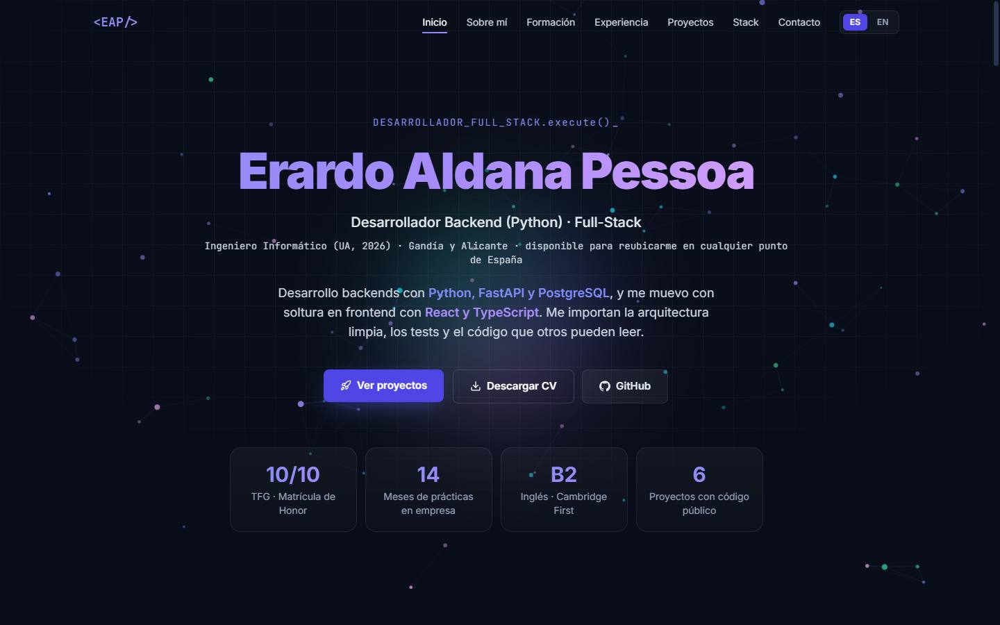 | 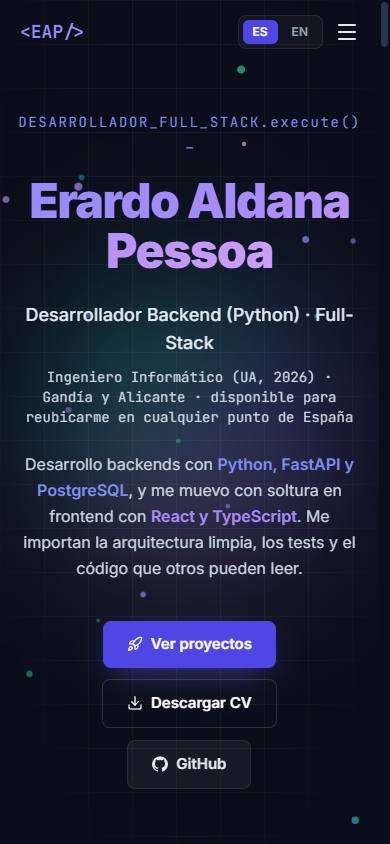 |
| Proyectos | 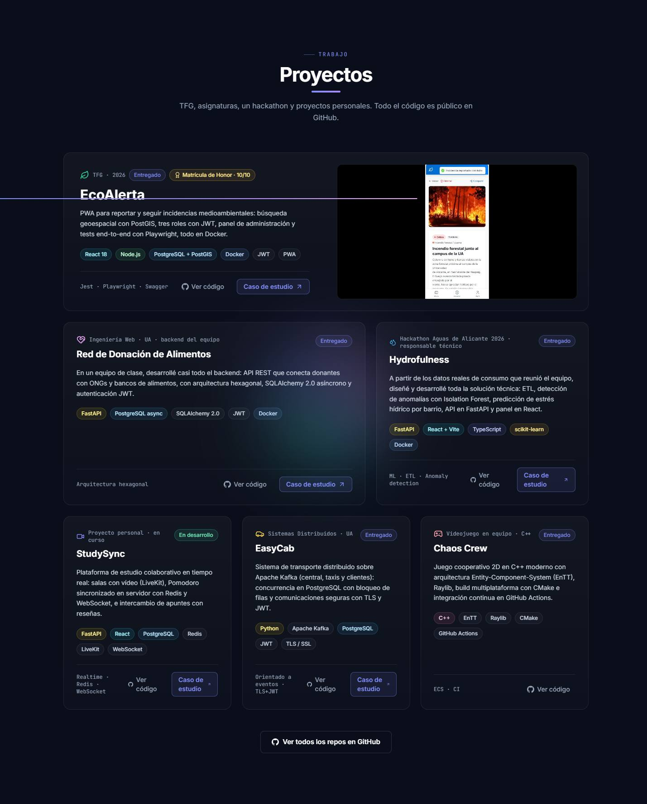 | 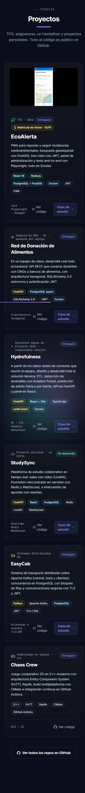 |

Resto de secciones en [fase-2/antes/](fase-2/antes/): sobre mí, formación, experiencia, stack, contacto y un case study.

---

## 2. Crítica de diseño (Impeccable `/critique`)

> ⚠️ DEGRADED: single-context (sin subagentes en esta sesión; detector no disponible en modo sin binario)

### Veredicto de especificidad: *intercambiable con cualquier portfolio de dev*
Si cambias el nombre, la página vale para cualquier otro desarrollador. Impeccable describe este aspecto como el más repetido en interfaces generadas por IA: **"casi negro con un acento neón y bordes que brillan"**. Los rasgos concretos son:
- el nombre en texto degradado (`gradient-text` en `Hero.tsx`);
- la constelación de partículas;
- una etiqueta pequeña ("eyebrow") encima del título en las 7 secciones, más el título centrado y la barra subrayada;
- las cuatro cifras grandes del hero (la plantilla "hero-metric");
- tarjetas de icono + título + texto del mismo tamaño en Contacto y Stack;
- monoespaciada usada como disfraz de "técnico" (`DESARROLLADOR_FULL_STACK.execute()`).

Lo único que no es de plantilla son **los vídeos de los proyectos y el contenido**, que ahora es verdadero.

### Puntuación (heurísticas de Nielsen)
La web es un portfolio, así que las heurísticas 7 y 10 no aplican y el total es sobre 32.

| # | Heurística | Nota | Clave |
|---|---|---|---|
| 1 | Visibilidad del estado | 3 | Menú con sección activa y barra de progreso. En móvil no se sabe en qué sección estás |
| 2 | Lenguaje del usuario | 3 | Textos claros y ya verdaderos. `execute()` es jerga para una reclutadora |
| 3 | Control y libertad | 3 | Selector de idioma, "volver a proyectos", controles de vídeo |
| 4 | Consistencia | 2 | Todas las secciones tienen la misma estructura, pero cada tarjeta lleva colores escritos a mano en el código, y los botones varían |
| 5 | Prevención de errores | 3 | Poco que prevenir. La descarga del CV va bien |
| 6 | Reconocer antes que recordar | 3 | Navegación siempre visible |
| 7 | Flexibilidad | n/a | Portfolio |
| 8 | Estética y minimalismo | 2 | Unos 10 efectos compiten. La página mide unos 12.000 px en móvil |
| 9 | Recuperación de errores | 3 | Hay página 404 con salida |
| 10 | Ayuda | n/a | Portfolio |
| **Total** | | **22/32** | **Aceptable**: la técnica es sólida y la identidad, genérica |

### Lo que funciona
1. **Prueba real:** los vídeos de 4 proyectos muestran el software funcionando, y eso vale más que cualquier efecto.
2. **El contenido es cierto y concreto** después de la fase 1.
3. **El borde que se ilumina por proximidad** (`GlowBorders`) y **la línea de tiempo que se dibuja con el scroll** son trabajo de oficio, no de plantilla.

### Problemas prioritarios
- **[P1] Lo que te diferencia no está en el primer viewport.** El hero dice "Backend" en texto, pero lo que se ve es un nombre degradado sobre partículas. *Arreglo:* que el primer viewport **demuestre** algo de backend, no que lo afirme. Es lo que hace cada dirección de la sección 5.
- **[P1] La prueba (los proyectos) está a 3 pantallas.** Orden actual: Hero → Sobre mí → Formación → Experiencia → Proyectos. *Arreglo:* proyectos justo después del hero (ya acordado).
- **[P2] Todas las secciones tienen la misma gramática** (etiqueta, título centrado, barra, subtítulo y rejilla de tarjetas oscuras), así que la página no tiene ritmo. *Arreglo:* cada sección con su forma dentro de un mismo mundo visual.
- **[P2] Muchos efectos y ningún momento firma.** Partículas, aurora, cursor, brillo, inclinación, imán, texto desordenado, degradado y entradas compiten entre sí. *Arreglo:* un momento firma por pantalla (el inventario de la sección 4).
- **[P2] Móvil:** 13 px de scroll horizontal, "Full-/Stack" partido, botones partidos en todas las tarjetas y "Alican-te" partido en Contacto.

### Qué falla para cada persona
- **Reclutadora, 30 segundos, desde LinkedIn en el móvil:** ve un nombre degradado, una etiqueta de código y cuatro cifras. Para llegar a un proyecto tiene que bajar unos 3.000 px. Los botones de las tarjetas se parten en dos líneas.
- **Tech lead que evalúa:** busca decisiones y código. Los case studies existen, pero se llega a ellos tarde, y su diagrama de arquitectura es una lista de cajas estática.
- **Sam (accesibilidad):** el cursor personalizado **oculta el cursor del sistema** (`cursor: none !important`) y sigue al ratón con retraso. Con movimiento reducido la web se porta bien, salvo una regla global que lo anula todo (ver auditoría).

---

## 3. Auditoría técnica (Impeccable `/audit`)

| # | Dimensión | Nota | Hallazgo clave |
|---|---|---|---|
| 1 | Accesibilidad | 3 | Cursor nativo oculto. El botón de copiar email tiene un nombre accesible distinto del texto visible |
| 2 | Rendimiento | 3 | Móvil 89. CLS 0,139 (por encima del límite de 0,1). El 78 % del LCP es retraso de render por la entrada animada |
| 3 | Theming | 2 | Colores hex escritos en los componentes en lugar de tokens |
| 4 | Responsive | 2 | Scroll horizontal y palabras y botones partidos en móvil |
| 5 | Integridad | 2 | Patrones de plantilla repetidos (lista en la crítica) |
| **Total** | | **12/20** | **Aceptable**: hay trabajo significativo |

**Hallazgos por gravedad**
- **[P1] Scroll horizontal de 13 px en móvil.** La fecha "feb 2020 — jun 2021 · 10 meses (2 períodos)" lleva `whitespace-nowrap` (`ExperienceCard` en [Experience.tsx](../../src/components/sections/Experience.tsx)). *Arreglo:* dejar que se parta en móvil.
- **[P1] CLS 0,139 en móvil.** El hero estático de `index.html` y el de React no son iguales: color `slate-400` frente a `slate-300`, y `<p>` frente a `<div>`. *Arreglo:* que sean idénticos, o renderizar el hero en el build.
- **[P1] El cursor del sistema queda oculto** con `cursor: none !important` en todo ([index.css](../../src/index.css), hacia la línea 122). *Arreglo:* no sustituir nunca el cursor del sistema.
- **[P2] Bucles de animación que no paran nunca**, aunque no se mueva nada: el cursor personalizado y la aurora llaman a `requestAnimationFrame` sin parar, y la aurora es además una capa fija con un desenfoque de 64 px.
- **[P2] El nombre accesible del botón de copiar email** no coincide con su texto visible ([Contact.tsx](../../src/components/sections/Contact.tsx)).
- **[P2] Colores escritos a mano** en `Projects.tsx` (GLOW), `Education.tsx` (FP_LAYOUT), `Contact.tsx` y `AuroraCursor.tsx`.
- **[P2] Palabras y botones partidos:** "Full-Stack", "Alican-te" y los enlaces de las tarjetas.
- **[P3] Los botones no tienen estado `:active`**; el menú móvil aparece de golpe; el vídeo de EcoAlerta (6,8 MB) no tiene póster.
- **[P3] Regla global de movimiento reducido:** `animation-duration: 0.001ms !important` anula también el feedback útil. Movimiento reducido debe significar *menos* movimiento, no *ninguno*.

**Lo positivo que hay que conservar:** cada componente comprueba `useReducedMotion`, los efectos se cargan en diferido, las páginas de proyecto están prerenderizadas con su imagen OG, hay tests de i18n y de datos, estilos `:focus-visible` y secciones semánticas.

---

## 4. Animación

### 4.1 Inventario de efectos actuales (revisado con `review-animations` y `emil-design-eng`)
Criterio acordado: **solo se quitan los que empeoran la usabilidad o el rendimiento**; el resto se pule o se traduce a la dirección elegida.

| # | Efecto | Dónde | Veredicto | Por qué |
|---|---|---|---|---|
| 1 | Constelación de partículas | Hero (`ParticleField`) | **Transformar** | Ya se pausa fuera de pantalla, así que no es un problema de rendimiento. Es el tópico de los portfolios de dev; en cada dirección pasa a ser algo con significado (trenes, albarán, paletas) |
| 2 | Texto que se desordena | Etiqueta del hero (`ScrambleText`) | **Mantener la idea** | Es tuyo y tiene carácter. La dirección C lo lleva al máximo con el split-flap real. En A y B la etiqueta de código sobra |
| 3 | Entrada escalonada del hero (0,85 s × 7 elementos) | Hero | **Quitar** | Rendimiento: retrasa el LCP 2,1 s. El texto debe verse desde el primer fotograma; lo que se anima es lo secundario |
| 4 | Degradado animado en el nombre | Hero | **Quitar** | Resta legibilidad y es una de las marcas de plantilla que Impeccable veta. El énfasis va por peso y tamaño |
| 5 | Cursor personalizado (punto + anillo) | Global | **Quitar** | Usabilidad: oculta el cursor del sistema y le añade retraso. Una opción válida es una etiqueta "Ver caso" solo sobre los vídeos, sin ocultar el cursor |
| 6 | Aurora que sigue al cursor | Global | **Quitar** | Rendimiento: desenfoque de 64 px en una capa fija y un bucle que no para. Además duplica el efecto del borde con luz |
| 7 | Borde con luz por proximidad | Tarjetas (`GlowBorders`) | **Mantener y pulir** | Es el mejor efecto de la web. Pulir: guardar las medidas en caché y procesar solo lo visible. Cada dirección lo traduce: en A se resalta la línea, en B el láser del escáner, en C la fila en ámbar |
| 8 | Inclinación 3D | Tarjetas | **Pulir** | Sobre bloques de texto molesta para leer. Solo en piezas que son objetos (el albarán de B) |
| 9 | Botones magnéticos | CTAs y enlaces de tarjeta | **Pulir** | Solo en el CTA principal. En los enlaces de tarjeta, que se usan decenas de veces, estorba |
| 10 | Aparición genérica (opacidad + Y + rotateX + escala) | Todas las secciones | **Sustituir** | La misma entrada en todas partes es la marca de plantilla. Cada sección debe tener su movimiento propio |
| 11 | Línea de tiempo dibujada con scroll | Experiencia | **Mantener** | Indica estado y explica. En A es literalmente una línea de metro |
| 12 | Rebote (`back.out(1.5)`) en Formación | Formación | **Pulir** | El rebote en contenido parece un juguete; mejor `ease-out` |
| 13 | Aparición de tarjetas con GSAP | Proyectos | **Sustituir** | Pasa a ser la cinta (B), los trenes (A) o el panel (C) |
| 14 | Aparición escalonada de chips (15 ms) | Stack | **Mantener** | Rápida y decorativa; no bloquea nada |
| 15 | Cinta de logos | Stack | **Mantener** | Lleva `aria-hidden` y se pausa con el cursor |
| 16 | Barra de progreso de scroll | Global | **Mantener** | En A puede ser un tren recorriendo la línea |
| 17 | Lenis (scroll suave) | Global | **Mantener** | Ya se desactiva con movimiento reducido. Hay que revisarlo junto al sticky de B |
| 18 | Mano que saluda | Sobre mí | **Mantener** | Ocurre una vez y es un detalle de simpatía bien puesto |
| 19 | Pastillas sociales que flotan sin parar | Sobre mí | **Quitar** | Usabilidad: un botón que no deja de moverse es un objetivo de clic en movimiento |
| 20 | Pulso del botón "Caso de estudio" al pasar por la tarjeta | Proyectos | **Quitar** | Pide atención decenas de veces por visita |
| 21 | Anillo pulsante del punto "disponible" | Sobre mí y Contacto | **Mantener** | Comunica un estado |
| 22 | Transición del título de la tarjeta al case study | Proyectos → case study | **Mantener y ampliar** | Da continuidad espacial; extender al vídeo |
| 23 | Vídeo que se reproduce al entrar en pantalla | Proyectos | **Mantener** | Con póster en todos los proyectos |

### 4.2 Oportunidades nuevas (`find-animation-opportunities`)

| # | Lugar | Hoy | Propósito | Frecuencia | Movimiento propuesto |
|---|---|---|---|---|---|
| 1 | [Button.tsx](../../src/components/ui/Button.tsx) | Ningún botón responde al pulsar | Feedback | Decenas de veces por visita | `:active { transform: scale(0.97) }`, `transition: transform 160ms cubic-bezier(0.23,1,0.32,1)`. Los prototipos ya lo llevan |
| 2 | [Navbar.tsx:112](../../src/components/layout/Navbar.tsx#L112) | `{open && (…)}`: el menú móvil aparece y desaparece de golpe | Evitar un cambio brusco | Ocasional | Entra con `opacity 0 → 1` + `translateY(-8px) → 0` en 200 ms ease-out y sale en 150 ms. Con movimiento reducido, solo opacidad |
| 3 | [Contact.tsx:119](../../src/components/sections/Contact.tsx#L119) | "¡Copiado!" sustituye al email de golpe | Feedback | Ocasional | Fundido cruzado de 150 ms con `blur(2px)` durante el cambio |
| 4 | Diagrama del case study | Lista estática de cajas | Explicación | Raro (una vez por visita) | **Pieza firma A**, ver cada dirección |
| 5 | Tarjeta → case study | Solo el título hace la transición | Continuidad espacial | Ocasional | Extender la transición al vídeo o póster |

**Descartadas:**
- Contar hacia arriba las cifras del hero: son datos que se leen, y además es la plantilla hero-metric.
- Parallax en bloques de texto: estorba la lectura.
- Animar los enlaces del menú al pasar el cursor: es una acción frecuente y ya tienen subrayado.
- Escalar los chips del stack al pasar el cursor: frecuente y sin propósito.

**Veredicto:** la web no necesita *más* movimiento, sino **un momento firma por pantalla** y menos ruido de fondo. La palanca más grande es la pieza firma A.

---

## 5. Las tres direcciones

Las tres comparten el mismo punto de partida: **que el primer viewport demuestre que eres backend, en vez de decirlo**. Y las tres se apoyan en tu historia real, no en un "tema bonito".

Lo que he descartado al derivarlas:
- **La rutina de la categoría:** fondo oscuro con neón y partículas (la web actual) y su contrario predecible, el portfolio blanco de solo texto.
- **Las herramientas que usas a diario** (terminal, dashboard de observabilidad), que Impeccable cuenta como disfraz. Las he dejado como mucho como una candidata más.

---

### Dirección A — "Línea Backend" (plano de metro) · **mi recomendación**
Rama `proto/a-metro`

**Concepto.** Tu carrera y tu stack dibujados como un plano de metro. La **línea 1 es tu trayectoria real**: SMR 2016 → DAM → Autis → DAW → Grado UA → NTT Data → TFG 10/10, y termina con la **próxima estación: "Tu equipo"**, en punteado. Las líneas 2, 3 y 4 son capas del stack (Frontend, Datos y Distribuidos), y cada proyecto está donde se cruzan. Por ejemplo, Hydrofulness está en el cruce de Frontend y Datos.

**Por qué cuenta que eres backend.** Un plano de metro es un diagrama de enrutamiento, que es exactamente lo que hace un backend. La pieza firma encaja de forma natural: una petición es un tren que recorre estaciones.

| | |
|---|---|
| **Tipografía** | Barlow Condensed (rotulación de señalética) para títulos y estaciones, Barlow para el texto y JetBrains Mono solo para código |
| **Color** | Papel de plano `#F3F1EA`, tinta `#15171B` y colores de línea con significado: rojo trayectoria, verde frontend, azul datos, violeta distribuidos. Es la estrategia de "paleta completa" con roles nombrados. **Pasa a modo claro**: el escenario es una reclutadora en su mesa, de día, desde LinkedIn |
| **Layout** | Hero partido: nombre y texto a la izquierda, plano a la derecha. En móvil el plano va justo debajo del nombre. Los proyectos son **líneas numeradas** (no tarjetas): número, nombre, contexto, texto, enlaces, y debajo una línea de su color con su stack como estaciones |
| **Movimiento** | Las líneas se dibujan al cargar (1,1 s), las estaciones aparecen escalonadas (70 ms) y los trenes recorren las líneas en bucle lento, con `ease-in-out` y deteniéndose en los extremos. "Tu equipo" late suavemente. Al pasar el cursor por un proyecto, un tren recorre su línea (900 ms). El texto se ve desde el primer fotograma. Con movimiento reducido, todo queda estático y dibujado |
| **Transiciones entre secciones** | Cada sección es una "parada": un rótulo de estación con su número de línea hace de cabecera, en lugar de la etiqueta pequeña que veta Impeccable. La barra de progreso es un tren sobre la línea 1 |
| **Pieza firma A** | **El viaje de una petición** en Food Donation: `POST /donations` es un tren que para en Router → Auth JWT → Caso de uso → Dominio → Repositorio → PostgreSQL. Cada estación abre el fragmento de código real de esa capa. El 401 y el 422 son desvíos a una vía muerta. Funciona con teclado (cada estación es un botón) y con movimiento reducido (pasos sin animación) |
| **Referencias** | Mapa del metro de Nueva York de Massimo Vignelli (1972), mapa del metro de Londres de Harry Beck (1931) y la señalética de TfL (tipografía Johnston), el plano esquemático de Metrovalencia, y el lienzo de servicios de railway.com como precedente de "sistema dibujado como red" |
| **Riesgo honesto** | Es el cambio más grande (de oscuro a claro). El plano hay que dibujarlo a mano y mantenerlo cuando añadas proyectos. En móvil el plano queda pequeño: legible, pero denso |
| **Esfuerzo para el resto de la web** | Medio-alto. Las secciones restantes son sencillas en este lenguaje (la experiencia ya es una línea de tiempo); la pieza firma es lo más costoso |

| | Escritorio | Móvil |
|---|---|---|
| Hero | 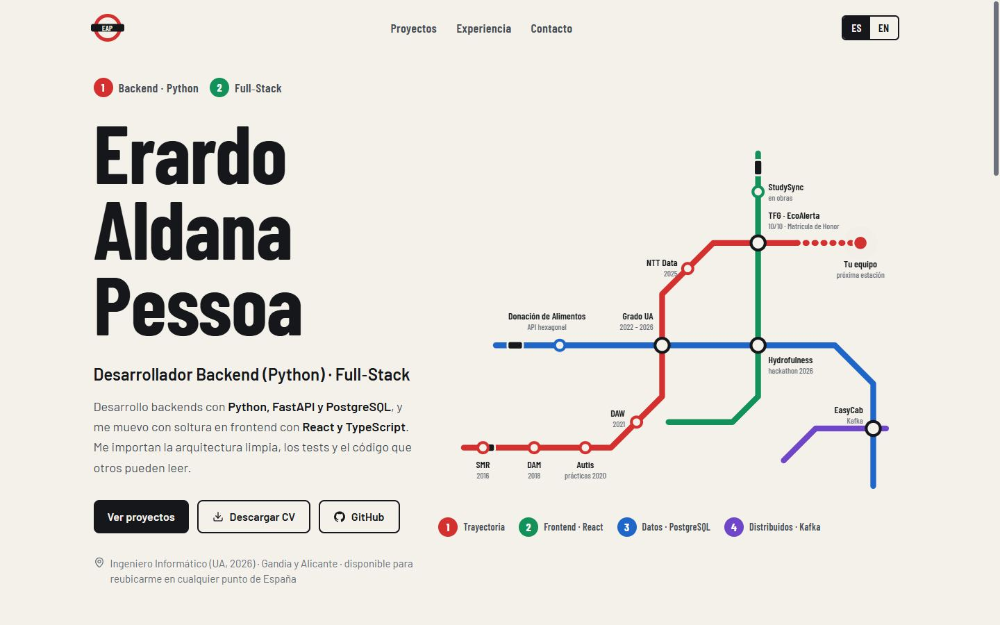 | 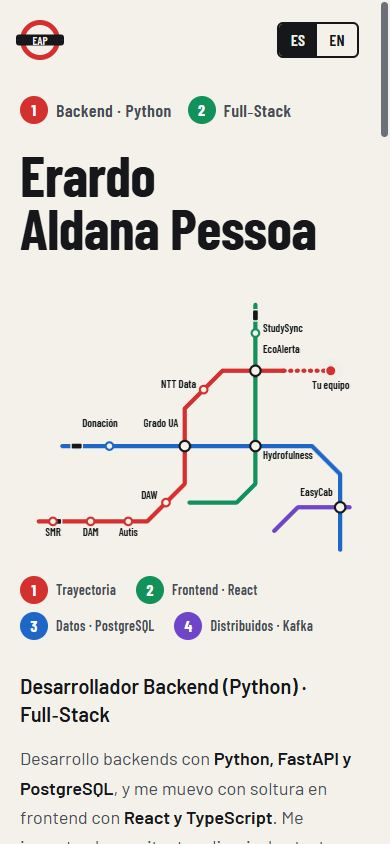 |
| Proyectos | 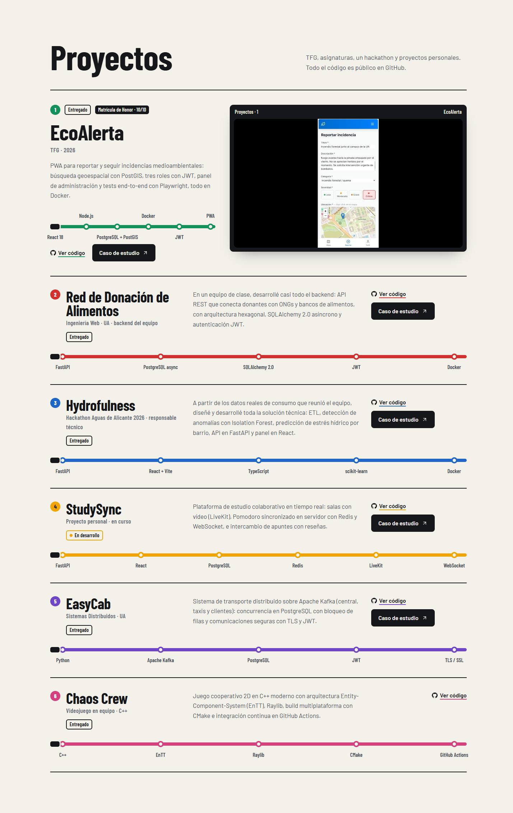 | 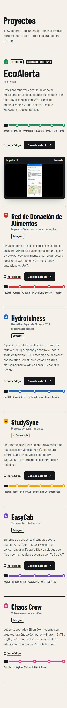 |
| Interacción | 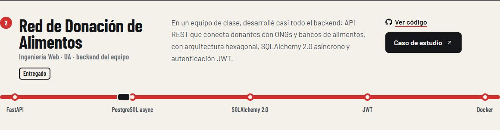 *El tren recorre la línea al pasar el cursor* | |

---

### Dirección B — "Albarán" (muelle de carga)
Rama `proto/b-albaran`

**Concepto.** El portfolio como un muelle de carga. El titular es **"De mover palés a mover peticiones."**, que es tu historia real: mozo de almacén, operario de producción y ahora backend. Al lado hay un **albarán de envío**: remitente tú, destinatario "Tu equipo de desarrollo", contenido "Backend (Python) · Full-Stack", 6 bultos y 14 meses de recorrido. El albarán aterriza en el suelo y recibe el **sello "Matrícula de Honor"**. Los proyectos son **bultos en una cinta transportadora**: avanzan al hacer scroll, pasan por un **escáner láser** y se sellan como ENTREGADO o EN TRÁNSITO.

**Por qué cuenta que eres backend.** La logística es colas, enrutado y procesado, el mismo modelo mental que un backend. Y es la única dirección que convierte tu historia fuera del sector en un punto fuerte memorable.

| | |
|---|---|
| **Tipografía** | Big Shoulders Display (rotulación industrial), Archivo para el texto y JetBrains Mono para códigos de seguimiento |
| **Color** | Suelo de almacén `#18191C`, papel térmico `#F4F1E8`, amarillo de seguridad `#FFD200` para las acciones y rojo de tampón para los sellos. Estrategia "comprometida": el amarillo es el color de toda acción |
| **Layout** | Hero partido: titular enorme a la izquierda y el albarán a la derecha. Una cinta de peligro separa el hero del muelle. Los proyectos van en una cinta horizontal fijada (sticky) mientras haces scroll; en móvil, una pila de etiquetas |
| **Movimiento** | El albarán cae con un muelle (`spring`, rebote 0,22: es un momento único, así que el rebote está justificado). El sello entra a los 950 ms en 180 ms ease-out. El albarán se inclina hacia el cursor con muelle. La cinta y sus rodillos se mueven con el scroll, y los sellos aparecen al cruzar el láser |
| **Transiciones entre secciones** | Cintas de peligro como marcas de suelo; cada sección es una "zona" del almacén con su rótulo (recepción, muelle, expediciones) |
| **Pieza firma A** | La petición es un bulto: escáner (validación JWT) → clasificación (router) → estación de procesado (caso de uso y dominio) → almacén (PostgreSQL). Si falla, sale una etiqueta "DEVUELTO · 401" |
| **Referencias** | La etiqueta logística GS1 (estándar SSCC), las etiquetas térmicas de paquetería, los colores de seguridad de la norma ISO 3864, y Teenage Engineering como referente de tipografía industrial en web |
| **Riesgo honesto** | Es la más arriesgada en lectura: una reclutadora con prisa podría quedarse con "almacén" en vez de con "ingeniero". El titular tiene que ir acompañado del rol, como en el prototipo. La cinta fijada hace la sección muy alta en escritorio. El código de barras es **decorativo** y va marcado así; en la versión final sería un Code 128 real |
| **Esfuerzo para el resto de la web** | Alto. Hay que convertir cada sección en una "zona" y la cinta necesita cuidado con Lenis y el scroll |

| | Escritorio | Móvil |
|---|---|---|
| Hero | 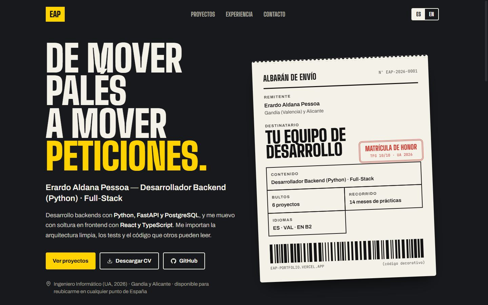 | 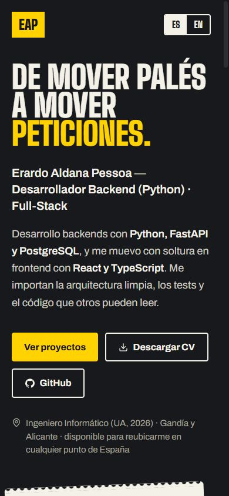 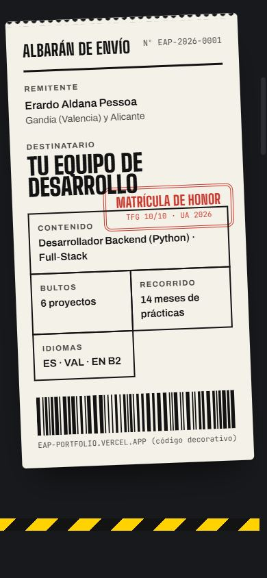 |
| Proyectos | 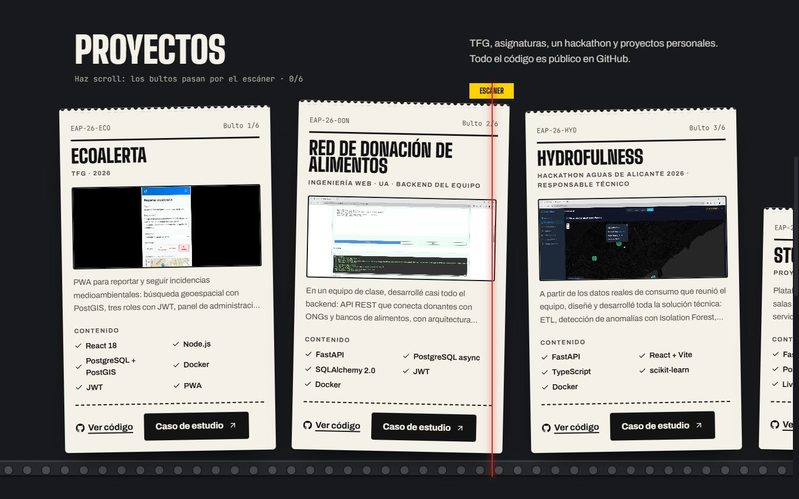 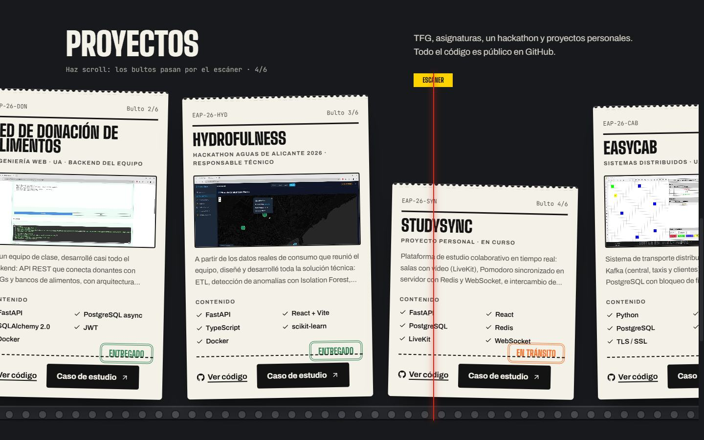 *A mitad de scroll: 4 de 6 escaneados* | 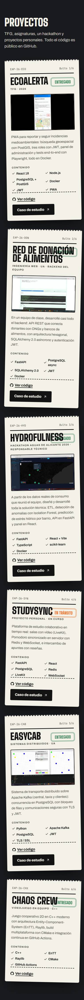 |

---

### Dirección C — "Panel de salidas" (split-flap)
Rama `proto/c-salidas`

**Concepto.** El portfolio como un panel de salidas de estación o aeropuerto. **Tu nombre entra paleta a paleta**: es la evolución directa de tu `ScrambleText` (en la captura intermedia se ve "ALDANK" y "PESS9A" a medio asentar). Debajo, una tabla de salidas: *Desarrollador Backend (Python) · vía Python · FastAPI · PostgreSQL · **DISPONIBLE***, *Full-Stack · EN HORA*, *Cualquier punto de España · reubicación · ABIERTO*. Hay un reloj en vivo en la cabecera. Los proyectos son **filas del panel** con su vía (stack) y su estado; se despliegan con su demo.

**Por qué cuenta que eres backend.** Un panel de salidas es una vista en tiempo real de un sistema de estados. Es la dirección que **más conserva tu identidad actual** (oscura y con texto que se transforma), pero con un significado concreto.

| | |
|---|---|
| **Tipografía** | Antonio (condensada, de panel), Hanken Grotesk para el texto y JetBrains Mono para la hora |
| **Color** | Noche `#0B0B0D`, panel `#131316`, paletas `#1C1C20`, caracteres ámbar `#FFB81C` y blancos, y estados con significado: verde disponible o entregado, ámbar en curso |
| **Layout** | El hero es un gran panel a todo el ancho con el texto y los CTAs debajo. Los proyectos son una tabla dentro de otro panel; EcoAlerta va desplegada por defecto |
| **Movimiento** | Cada carácter pasa por 4 a 8 letras (cada paso dura 62 ms y cada paleta arranca 38 ms después de la anterior) con un pliegue de 70 ms solo de `transform`. Las filas se abaten desde arriba (`rotateX`, 420 ms) y el acordeón abre en 260 ms ease-out. "DISPONIBLE" parpadea en pasos, como un panel real. El texto es **visible por defecto**: la animación solo lo refresca |
| **Transiciones entre secciones** | Cada sección es un "panel" (llegadas, salidas, servicios) que refresca sus líneas al entrar en pantalla |
| **Pieza firma A** | La petición como itinerario en directo: las filas del panel cambian de estado a medida que la petición avanza (AUTH · EMBARCANDO → DOMINIO · EN VUELO → DB · ATERRIZADO). Funciona, pero es **menos espacial** que en A o B: se ve el estado, no el recorrido |
| **Referencias** | Los paneles split-flap de Solari di Udine (estaciones de Renfe y aeropuertos de AENA) y Vestaboard como versión moderna del split-flap |
| **Riesgo honesto** | Es la más cercana a lo que ya tienes, así que es la que menos se diferencia del montón oscuro. El split-flap bien hecho es caro de pulir (en el prototipo tuve que corregir dos fallos de partición de palabras). En móvil las paletas del nombre quedan pequeñas |
| **Esfuerzo para el resto de la web** | Medio. Paneles y tablas se trasladan fácil al resto de secciones |

| | Escritorio | Móvil |
|---|---|---|
| Hero | 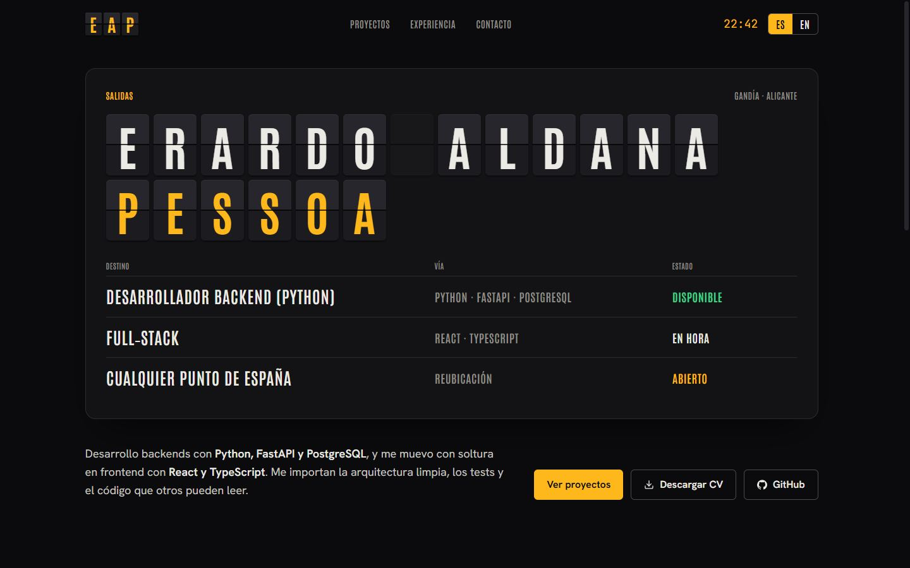 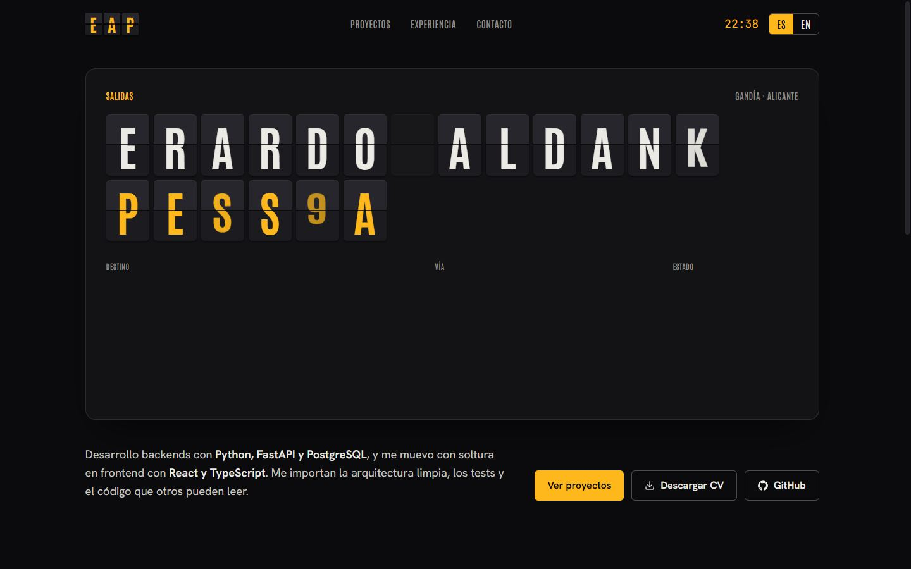 *Paletas a medio asentar* | 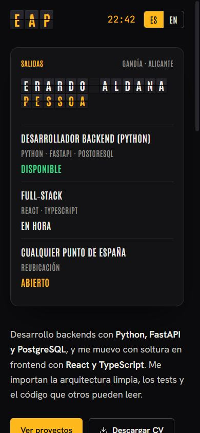 |
| Proyectos | 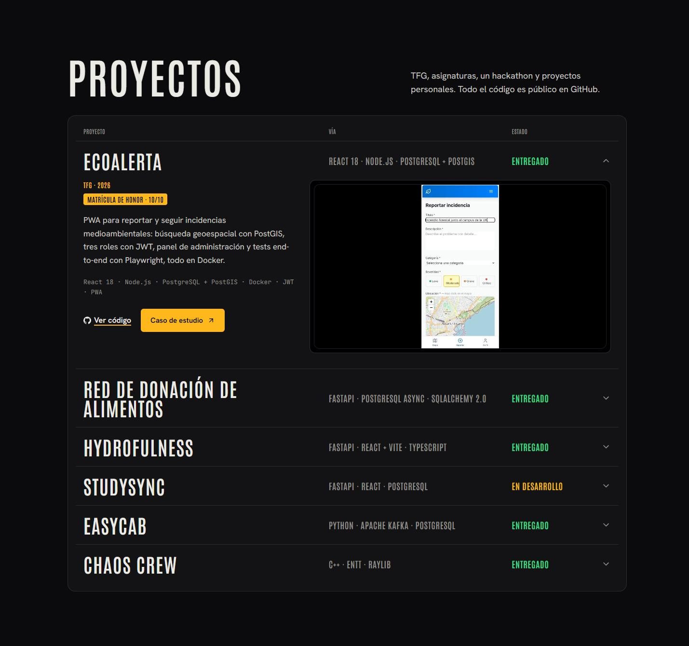 | 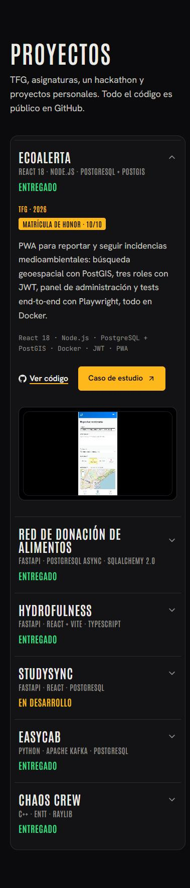 |

---

### Comparativa

| | A · Línea Backend | B · Albarán | C · Panel de salidas |
|---|---|---|---|
| ¿Demuestra backend en el primer viewport? | **Sí**: enrutado, red, recorrido | Sí, a través de la historia | A medias: estados, no flujo |
| ¿Es memorable una hora después? | Alta ("el portfolio del metro") | **Muy alta** ("de palés a peticiones") | Media-alta |
| ¿Se diferencia del montón oscuro? | **Total** (modo claro) | Alta | Media |
| ¿Encaja la pieza firma A? | **Natural** | Natural | Forzada |
| ¿Legible para una reclutadora con prisa? | **Alta** | Media (hay que leer el rol) | Alta |
| ¿Conserva tus efectos? | Los traduce (trenes, líneas) | Los traduce (caída, sello, láser) | **Los lleva al máximo** (scramble → split-flap) |
| Esfuerzo total | Medio-alto | Alto | Medio |
| Rendimiento previsto | SVG ligero y 2 fuentes | Sticky, 2 fuentes y muelles | Temporizadores de las paletas y 2 fuentes |

**Mi recomendación: A.** Es la que mejor cumple "que destaque, pero contando que soy backend":
- El plano **es** un diagrama de arquitectura.
- La pieza firma nace sola.
- Es legible en 30 segundos.
- Te separa del 90 % de portfolios de dev solo con el cambio a claro.

De B tomaría **la frase**, no el disfraz: "De mover palés a mover peticiones" puede abrir tu historia en "Sobre mí" dentro del mundo A. Es una idea de texto, no visual, y no mezcla mundos. Si prefieres conservar lo oscuro, **C** es la opción segura y bien hecha.

---

## 6. Arreglos comunes (se aplican elija la dirección que elija)
1. **Scroll horizontal en móvil:** la fecha de Autis puede partirse en móvil. *En los tres prototipos el scroll horizontal ya es 0 px.*
2. **"Full-Stack" sin partir:** se usa un guion no separable (`U+2011`), ya hecho en los prototipos.
3. **Botones que no se parten:** `whitespace-nowrap` y una distribución que deja sitio (hecho en los prototipos).
4. **"Gandía (Valencia) y Alicante" en Contacto:** quitar el corte de palabra.
5. **CLS < 0,1:** que el hero estático de `index.html` sea idéntico al de React, o renderizarlo en el build. El texto del hero sin entrada animada (ya así en los prototipos).
6. **Accesibilidad:** el cursor del sistema siempre visible; el nombre accesible del botón de copiar coincide con su texto; la regla global de movimiento reducido pasa de "nada" a "menos"; el menú móvil con transición y foco gestionado.
7. **Pósters en todos los vídeos.** EcoAlerta ya tiene uno, sacado del propio vídeo, en las tres ramas.
8. **Estado `:active` en todos los botones** (hecho en los prototipos).
9. **Orden de las secciones:** Hero → **Proyectos** → Experiencia → Sobre mí → Formación → Stack → Contacto.
10. **Objetivo de rendimiento:** Lighthouse móvil de 90 o más, CLS menor de 0,1 y LCP menor de 2,5 s, medido en cada commit grande.

---

## 7. Cómo seguiría tras elegir (fase 2b, siempre con plan y OK previos)
1. Escribir `PRODUCT.md` y `DESIGN.md` con los tokens de la dirección elegida, como pide Impeccable.
2. Construir el hero y los proyectos finales en `main`, a partir del prototipo (commits pequeños).
3. Rehacer el resto de secciones en el mismo mundo: Experiencia, Sobre mí (con tu historia), Formación, Stack, Contacto y la página de case study.
4. Arreglos comunes de la sección 6.
5. La pieza firma A en el case study de Food Donation (es la fase 3, pero ya diseñada para este mundo).
6. Una revisión final con `/critique` y Lighthouse, con capturas del después.

---

## 8. Decisiones (marca)
- **Dirección:**  [ ] A · Línea Backend  [ ] B · Albarán  [ ] C · Panel de salidas  [ ] ✏️ otra combinación:
- **Modo claro** (si eliges A):  [ ] OK  [ ] prefiero oscuro
- **Usar la frase "De mover palés a mover peticiones"** en Sobre mí:  [ ] Sí  [ ] No
- **¿Qué hago con las ramas `proto/*`?**  [ ] subirlas a GitHub para verlas en las previews de Vercel  [ ] dejarlas en local
- **¿Commiteo este documento y sus capturas (unos 3 MB) en `main`?**  [ ] Sí  [ ] Solo el `.md`  [ ] No
- **Algo de los prototipos que quieras cambiar antes de construir:**
